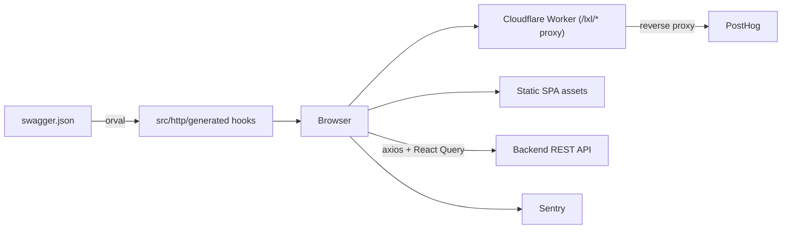

# JurisPro Web

Web client for a Brazilian labor-law case management and settlement calculator: public landing pages and calculators, plus an authenticated workspace for law firms.

**Status:** Deployed for a private client; this repository is a source-available portfolio copy. Product copy and UI strings are in Brazilian Portuguese.

## What it does

- Public marketing site with prerendered SEO pages (calculator landing pages, methodology, privacy, terms, LGPD).
- Public labor-calculation tools (worker, HR, single-verba calculators) and shareable calculation links.
- Authenticated app: cases, clients, calculations, agenda, workflow, templates (DOCX preview/validate), team and billing screens.
- Client portal flow: invite acceptance, login, password reset.
- Referral redirect and embeddable calculator widget (`public/widget.js`).
- In-app messaging over a server-sent-events stream (`src/components/messaging`).
- Command palette, guided tours, dark/light theme.

## Architecture



- The API client is generated from `swagger.json` with Orval (one file per OpenAPI tag); it is not committed.
- Pages are split by audience: `src/pages/{landing,public,portal,protected}`.
- A small Cloudflare Worker exists only to reverse-proxy analytics under an opaque path; everything else is static assets with SPA fallback.
- Public pages are prerendered at build time (`scripts/prerender.mjs`).

## Key engineering decisions

- Generated, typed API layer from the OpenAPI contract: `orval.config.ts`, `src/lib/api.ts`.
- Environment validated at startup with Zod, failing fast on bad config: `src/env/index.ts`.
- First-party analytics proxy so ad blockers do not skew funnel data: `worker/index.ts`, `wrangler.jsonc`.
- Prerendering plus `drop-trailing-slash` asset handling so legal pages resolve without redirects: `scripts/prerender.mjs`, `wrangler.jsonc`.
- Route-level error boundaries and subscription/plan feature gates: `src/components/route-error-boundary.tsx`, `src/components/plan-feature-gate.tsx`.

## Tech stack

React 19, TypeScript, Vite, React Router 7, TanStack Query, Tailwind CSS 4, shadcn/Base UI, react-hook-form + Zod, Orval, Sentry, PostHog, Cloudflare Workers, Vitest, Biome/ESLint.

## Getting started

Prerequisites: Node 22, pnpm 10, a running compatible backend (see Related repositories).

```bash
pnpm install
cp .env.example .env   # fill in values (also required to run tests)
pnpm dev               # generates the API client, then starts Vite
```

| Variable | Purpose |
|---|---|
| `VITE_HTTP_API_URL` | Backend API base URL |
| `VITE_STORAGE_URL` | Public object storage base URL |
| `VITE_DEFAULT_FGTS_RATE` | Default FGTS rate (percent) |
| `VITE_DEFAULT_MINIMUM_WAGE` | Default minimum wage |
| `VITE_SENTRY_DSN` | Optional Sentry DSN |
| `VITE_POSTHOG_KEY` | Optional PostHog public project key |
| `VITE_POSTHOG_HOST` | Leave empty to use the first-party proxy |

## Testing

20 test files, 119 tests, passing with `.env` copied from `.env.example` (Vitest + Testing Library, jsdom). Coverage is thin for the size of the app: mostly utilities, hooks and a few components.

```bash
pnpm exec orval && pnpm test
npx tsc -b
```

## Project structure

```text
src/pages/        landing, public, portal, protected (app) routes
src/components/   shared and ui primitives
src/lib/          axios instance, analytics, session, query client
src/http/         generated API client (gitignored)
worker/           Cloudflare Worker (analytics proxy)
scripts/          prerender
swagger.json      API contract used for codegen
```

## Related repositories

- [jurispro-api](https://github.com/mkwitko/jurispro-api): backend for this client

## License

All rights reserved. Source available for portfolio review.
